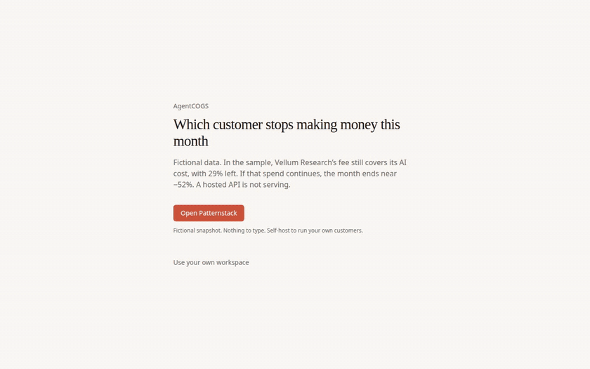

# AgentCOGS

AgentCOGS is an open-source Python SDK and a self-hosted dashboard for customer-level AI unit economics. It attributes each LLM call to the customer who caused it, compares that cost with the monthly fee, and checks a per-customer budget before the next SDK call.

**Know which AI customers make you money, and which ones are eating your margins.** The blended total can look fine while one fee no longer covers the AI cost. Which customer stops making money this month.

```bash
pip install agentcogs
```

This package is the SDK. It is on PyPI. The customer list is the dashboard in the [repository](https://github.com/vaibhav11123/agentcogs), and you run that yourself. A hosted API is not serving. The working sample is [agentcogs.vercel.app](https://agentcogs.vercel.app).

## What does the number mean?

AI margin is `(monthly fee − attributed AI cost) / monthly fee`. It is the contribution of the fee after attributed AI cost. It is not total customer profitability, and it is not accounting gross margin. People, infrastructure, support, payment processing, refunds, discounts, credits, and proration are outside it. Pace is a straight line from the cost so far. It does not forecast a change in behavior. You type the fee, or you pull that customer's Stripe subscription. The SDK does not invent it.

## Install, configure, instrument, verify

`AGENTCOGS_ENDPOINT` defaults to `http://localhost:8000`. Create a workspace with the self-hosted dashboard, then:

```python
import os
from openai import OpenAI
import agentcogs

agentcogs.init()  # AGENTCOGS_API_KEY, AGENTCOGS_WORKSPACE_ID, AGENTCOGS_ENDPOINT
print(agentcogs.ping())
agentcogs.set_customer("acme")  # your tenant id, once per request

with agentcogs.run(workflow_id="support") as ctx:
    if os.environ.get("OPENAI_API_KEY"):
        OpenAI().chat.completions.create(
            model="gpt-4o-mini",
            messages=[{"role": "user", "content": "Say hi in one word."}],
            max_tokens=5,
        )

print(ctx.wait_for_ingest().accepted, ctx.run_id)
```

The SDK does not call a model. Inside the block, shekel reads token usage from the OpenAI or Anthropic call you make. When the block exits, that cost is posted. With no `OPENAI_API_KEY`, the same block posts a zero-cost run so you can see the row. Open that customer and type the monthly fee.

`python examples/hello_agentcogs.py` in the repository is this path. `python examples/one_run.py` posts one recorded cost of USD 0.84 and does not call a model.

## How attribution works

`set_customer()` names the tenant for this request. `run()` watches the instrumented client calls in the block and posts one event with `total_usd` when the block exits. If no customer is set, `run()` raises before the block. A duplicate `run_id` is accepted as a duplicate and is not stored twice. A failed post sits in a local outbox and is retried. `python -m agentcogs outbox status` shows what has not been delivered. When `POSTHOG_PROJECT_API_KEY` is set, that command sends its name, the package version, and success or failure to PostHog (`POSTHOG_HOST`, default `https://us.i.posthog.com`). That event leaves out prompts, customer names, API keys, and amounts. Leave the key unset and nothing is sent.

## What the budget check does

If `monthly_budget_usd` is already exceeded, the next `run()` raises `CustomerBudgetExceededError` and does not enter the block. Two calls already in flight can both pass. It is not an atomic reservation. A LiteLLM callback records cost after the provider has already answered, so it cannot stop that call.

LiteLLM does not ship the callback. You copy it from the repository. The FastAPI middleware is a separate extra: `pip install "agentcogs[integrations]"`.

## Supported integrations

| | |
| --- | --- |
| OpenAI and Anthropic | Usage read inside `run()` by shekel, which this package depends on |
| [FastAPI](https://github.com/vaibhav11123/agentcogs/blob/main/docs/integrations/fastapi.md) | Set the tenant from the request. Needs the `integrations` extra |
| [LangGraph](https://github.com/vaibhav11123/agentcogs/blob/main/docs/integrations/langgraph.md) | Wrap the graph |
| [LiteLLM](https://github.com/vaibhav11123/agentcogs/blob/main/docs/integrations/litellm.md) | A callback you register. It posts after the proxy call |
| Stripe | The subscription is the fee. An optional meter pushes usage you already attributed |
| [Slack](https://github.com/vaibhav11123/agentcogs/blob/main/docs/integrations/slack.md) | A spike opens that customer |

## One fictional account

[Patternstack](https://agentcogs.vercel.app) is a snapshot of forty fictional customers, as of 14 Nov 2026. The blended AI margin is 74.6%. Vellum Research has spent USD 5,822.84 against a fee of USD 8,200, so it is 29.0% so far, and the straight-line pace ends near −52.2%. The sample does not receive your calls.



## Documentation

- [Quickstart](https://github.com/vaibhav11123/agentcogs/blob/main/docs/quickstart.md)
- [Self-host](https://github.com/vaibhav11123/agentcogs/blob/main/docs/DEPLOY.md)
- [Customer id](https://github.com/vaibhav11123/agentcogs/blob/main/docs/concepts/customer-id.md)
- [Docs index](https://github.com/vaibhav11123/agentcogs/blob/main/docs/README.md)
- [Repository README](https://github.com/vaibhav11123/agentcogs/blob/main/README.md)
- Sample: https://agentcogs.vercel.app
- Source: https://github.com/vaibhav11123/agentcogs

## What is not guaranteed

A match against the provider invoice, refunds, credits, discounts, currency conversion, and a hard stop when two calls pass the pre-check together. Development status is Beta: the SDK surface is `init`, `set_customer`, `run`, `ping`, and `shutdown`, and a hosted API is not part of this release.
