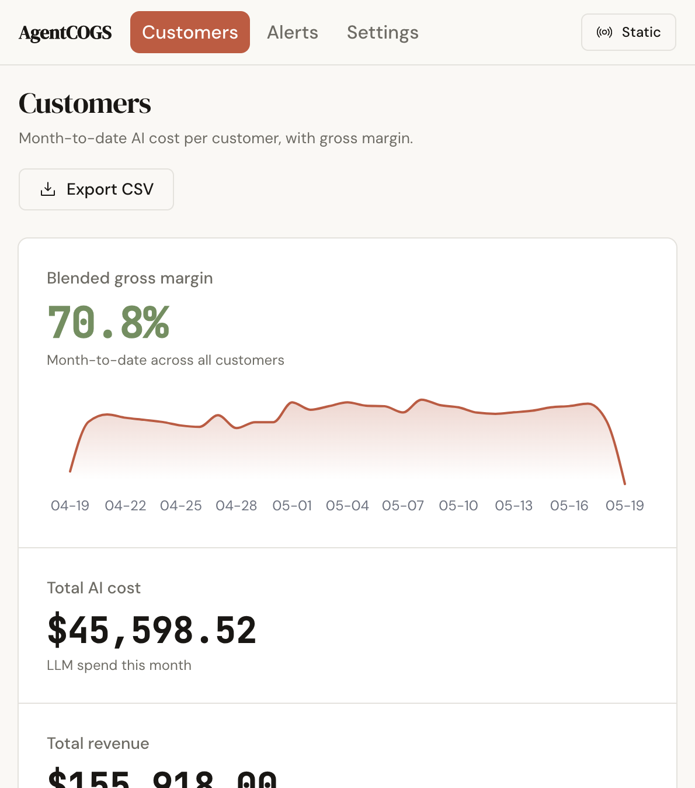
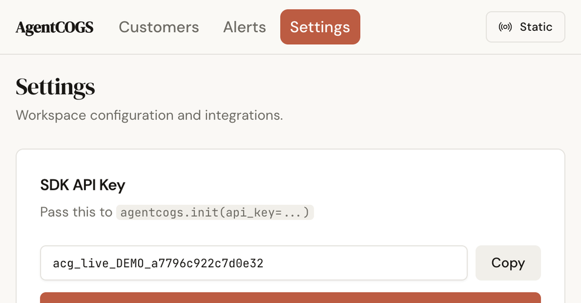
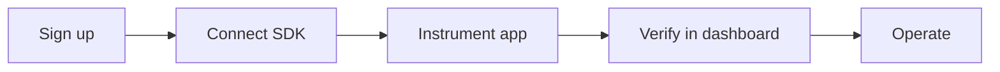
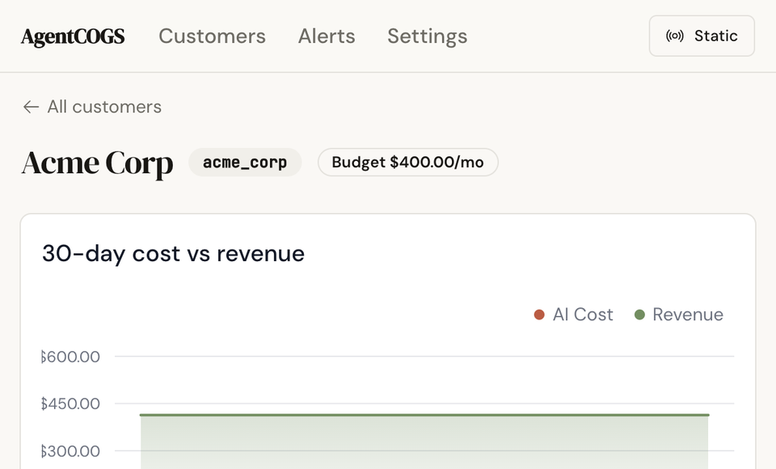
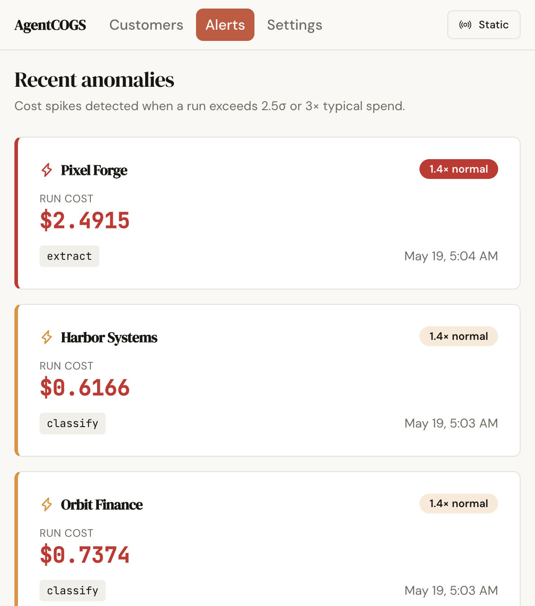
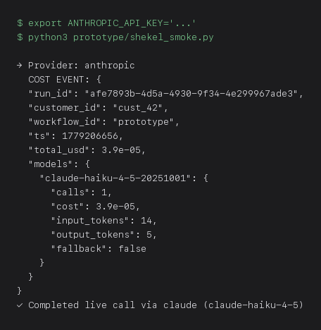
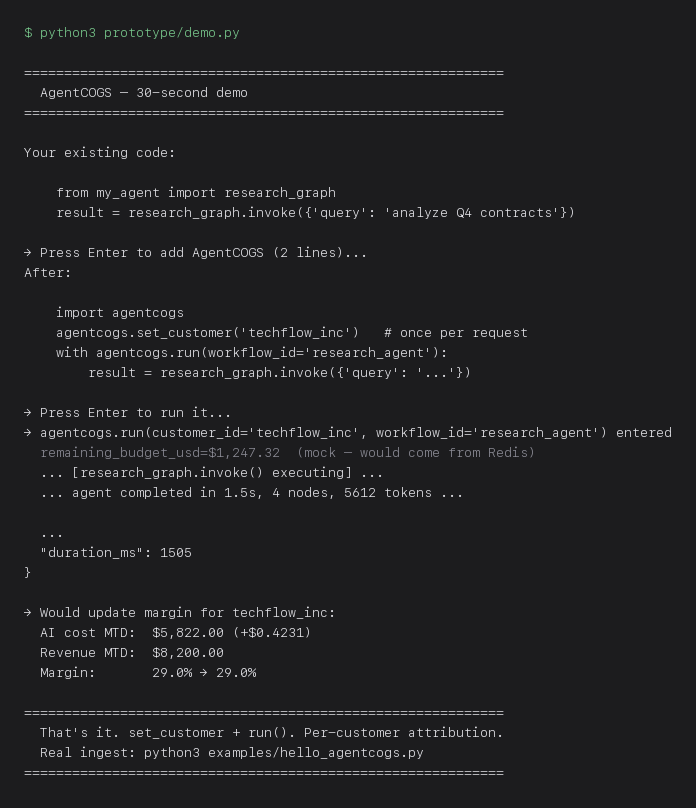
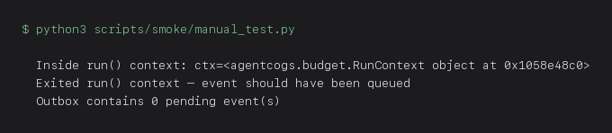
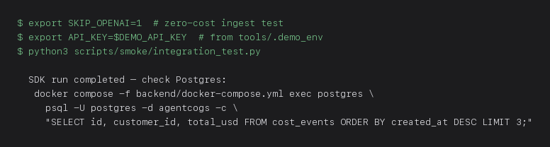

# AgentCOGS

**Which customer stops making money this month.** One agent call posts one cost. AgentCOGS adds those calls up per customer, sets them against the monthly fee, and can stop the next call.

[](LICENSE)
[](https://www.python.org/downloads/)
[](https://github.com/vaibhav11123/agentcogs/actions/workflows/ci.yml)

> [!NOTE]
> **Open the sample company:** [agentcogs.vercel.app](https://agentcogs.vercel.app) — one click, nothing to type. The sample is a snapshot shipped with the dashboard, so it opens when the hosted API is down.  
> **Self-host the live product:** `cp .env.selfhost.example .env && docker compose up -d --build` → [docs/DEPLOY.md#self-host](docs/DEPLOY.md#self-host)

<p align="center">
  
</p>

<p align="center">
  <em>In the sample, Vellum Research is 29% so far. If the calls continue, the month ends near -52%. The code that posts each call is below.</em>
</p>

---

## The problem

You sell AI agents to **other companies** (tenants). Each tenant runs different workflows, models, and volumes. Your LLM bill is one number on the provider invoice — but **finance needs it per customer**.

| Without AgentCOGS | With AgentCOGS |
|-------------------|----------------|
| Export Langfuse / proxy logs into Excel | Live leaderboard: cost, revenue, margin % per tenant |
| Guess which `userId` maps to which account | Use your existing `org_id` / `tenant_id` |
| Find out a customer is unprofitable at renewal | See margin and budget status before the QBR |
| No runtime guardrail when a tenant blows the budget | Optional `monthly_budget_usd` + `CustomerBudgetExceededError` |

> **Accurate by design.** AgentCOGS never infers the customer from context —
> if no `customer_id` is set, the run is unattributed rather than misattributed.
> Cost is the amount the SDK reported. Margin uses that cost against the
> customer's monthly revenue. Revenue stays typed until you pull it from
> Stripe subscriptions, and the pace figure is a straight daily projection.

---

## Who it's for

| Who | What you get |
|-----|----------------|
| **Founder / CFO** | Know which customers are profitable before the QBR, not after |
| **Backend engineer** | Two lines around existing agent code — `set_customer()` + `run()` |
| **Platform / infra** | Self-host full stack in your VPC — `cp .env.selfhost.example .env && docker compose up -d --build` ([docs/DEPLOY.md](docs/DEPLOY.md)) |
| **Finance / ops** | CSV export, Slack alerts on cost spikes, Stripe meter sync |

**Typical products:** vertical copilots, support agents, research bots, document pipelines — anything where **one subscription maps to many LLM runs per month**.

---

## How AgentCOGS compares

| Tool | What it does | How AgentCOGS relates |
|------|--------------|------------------------|
| **Langfuse / LangSmith** | Traces, spans, evals — total cost visible, not per customer | AgentCOGS splits that total by which tenant caused it and whether they're profitable |
| **LiteLLM proxy** | Routing, keys, team spend (Enterprise: customer leaderboard) | Works with — callback sends per-tenant cost without replacing LiteLLM |
| **Lago / Stripe Billing** | Invoicing, usage meters, subscriptions | AgentCOGS feeds attributed cost into Stripe; you bill customers based on real usage |
| **OpenAI / Anthropic invoice** | One number, no customer breakdown | AgentCOGS is the missing join key between that invoice and your customer list |

---

## Quick start

**1. Open the sample** — [agentcogs.vercel.app](https://agentcogs.vercel.app) and choose **Open Patternstack**. A live workspace is the self-host path above, then Settings → Rotate key for the API key.

**2. Run it on your machine**

```bash
cp .env.selfhost.example .env
docker compose up -d --build
```

Open http://localhost:3000 and choose **Create my workspace**. No email. The next screen shows the install command with your API key filled in. Send one call, then type the monthly fee on that customer. Margin is the fee minus the cost.

**3. Install and instrument**

```bash
pip install "agentcogs @ git+https://github.com/vaibhav11123/agentcogs.git"
```

```python
import agentcogs

agentcogs.init()  # AGENTCOGS_API_KEY + AGENTCOGS_WORKSPACE_ID from Settings
agentcogs.set_customer("vellum_research")  # your tenant id, once per request

with agentcogs.run(workflow_id="research_agent"):
    result = agent.invoke(state)
```

That block is what the customer page shows next to the dollar figure. One call in the sample is the research agent. The month is every call added up. Open the sample and read Vellum Research if you want to see it before you install.

The package is not on PyPI yet, so the install line above is the git URL. A hosted API is not serving. Self-host is the way a call from your agent lands in your workspace. `python examples/one_run.py` posts one recorded Vellum Research cost so you can see the event land. It does not call a model.

→ Full guide: [docs/quickstart.md](docs/quickstart.md)

<p align="center">
  
</p>

---

## Customer journey

North star: **first cost row in the dashboard in under 10 minutes**.



| Stage | You do | Product |
|-------|--------|---------|
| **Connect** | `docker compose up`, then the git install with the key on screen | `init()`, `ping()` |
| **Instrument** | `set_customer(tenant_id)` + `run(workflow_id=...)` | Cost at LLM boundary via Shekel |
| **Verify** | Run agent or `examples/hello_agentcogs.py` | Customer row + margin on leaderboard |
| **Operate** | Revenue, budgets, alerts, drill-down | Dashboard + optional Stripe sync |

See [customer-id mapping](docs/concepts/customer-id.md), [FastAPI](docs/integrations/fastapi.md), [LangGraph](docs/integrations/langgraph.md).

<p align="center">
  
</p>

<p align="center">
  
</p>

---

## Terminal output

SDK proof, live ingest, and smoke tests — commands in [docs/demo-paths.md](docs/demo-paths.md).

<p align="center">
  
</p>

<p align="center">
  
</p>

<p align="center">
  
</p>

<p align="center">
  
</p>

| Script | Output |
|--------|--------|
| `scripts/smoke/manual_test.py` |  |
| `scripts/smoke/integration_test.py` |  |

<p align="center">
  
</p>

---

## What you can do

| Capability | How it helps | Where |
|------------|--------------|-------|
| **Per-customer cost ingest** | Every LLM run tied to `customer_id` + `workflow_id` | SDK → `POST /v1/ingest` |
| **Margin leaderboard** | Sort tenants by who burns margin | Dashboard `/` |
| **Revenue per customer** | Compare AI cost to what they pay you | Editable in UI or import API |
| **Budget caps** | Stop runaway tenant before month-end | Dashboard + `CustomerBudgetExceededError` |
| **Cost by workflow node** | See if `classify` or `merge` dominates spend | Customer detail |
| **Outbox + retry** | Ingest survives brief API outages | `~/.agentcogs/outbox.db` |
| **Slack / email alerts** | Ops notified on cost spikes | [Slack integration](docs/integrations/slack.md) |
| **LiteLLM proxy callback** | Attribute proxy traffic without wrapping app code | [LiteLLM integration](docs/integrations/litellm.md) |
| **Customer import** | Pre-seed names, revenue, budgets before first run | `POST /v1/customers/import` |

---

## Integrations

| Integration | Use when |
|-------------|----------|
| [FastAPI](docs/integrations/fastapi.md) | `tenant_id` from `request.state` automatically |
| [LangGraph](docs/integrations/langgraph.md) | LangGraph graphs with `agentcogs_run()` |
| [LiteLLM](docs/integrations/litellm.md) | Traffic goes through LiteLLM proxy |
| [Slack](docs/integrations/slack.md) | Ops wants spike alerts in a channel |
| [Customer import](docs/integrations/customer-import.md) | Pre-load CRM tenants before first LLM event |

---

## Monorepo

| Path | Description |
|------|-------------|
| `src/agentcogs/` | git install until the PyPI release |
| `backend/` | Ingest + dashboard API |
| `dashboard/` | React UI |
| `docs/` | [Documentation index](docs/README.md) · [Deploy](docs/DEPLOY.md) |
| `examples/hello_agentcogs.py` | Minimal ingest example |

**Stack:** Python SDK · FastAPI · Postgres · Redis · React dashboard · MIT license.

---

## Contributing & license

- [CONTRIBUTING.md](CONTRIBUTING.md) — PRs welcome; run `./scripts/install-githooks.sh` after clone
- [SECURITY.md](SECURITY.md) — responsible disclosure
- [MIT](LICENSE)
