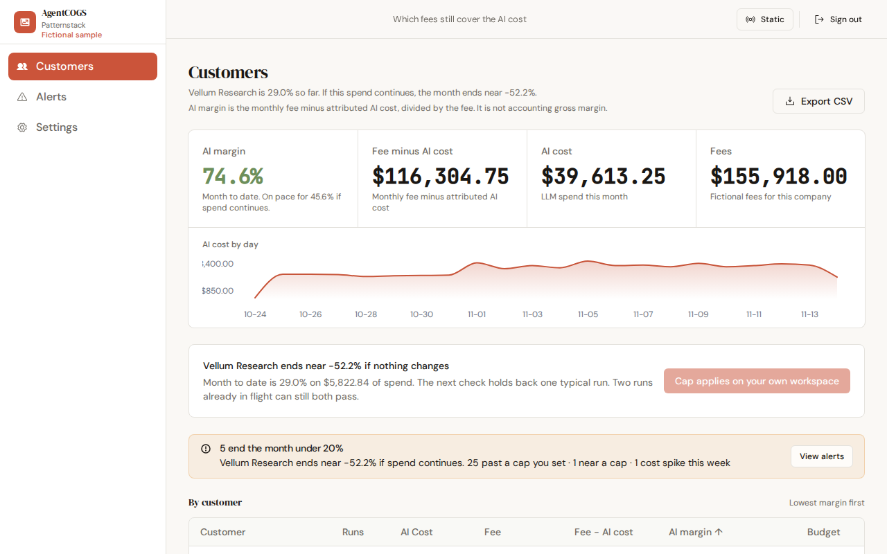
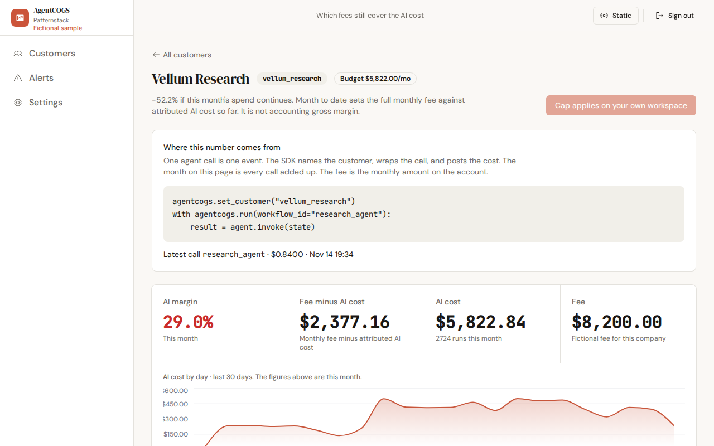

# AgentCOGS

**Which customer stops making money this month.**

You sell an agent to other companies. The model provider sends one invoice. AgentCOGS splits that spend by the tenant who caused it, sets it against the monthly fee, and shows where the month is headed if the calls keep coming.

[](LICENSE)
[](https://www.python.org/downloads/)
[](https://github.com/vaibhav11123/agentcogs/actions/workflows/ci.yml)

The sample company is [Patternstack](https://agentcogs.vercel.app). One click, nothing to type. It is a snapshot of a fictional book of business, shipped in the dashboard, so it opens when no API is running. A hosted AgentCOGS API is not serving. To run your own customers, self-host.

---

## The book, and the account inside it

Patternstack, as of 14 Nov 2026. Forty customers. The month so far looks healthy.

| | So far | If the calls continue |
| --- | ---: | ---: |
| AI cost | $39,613.25 | $84,885.54 |
| Fees | $155,918.00 | $155,918.00 |
| Margin | 74.6% | 45.6% |

The fee is the monthly amount on the account. Pace is a straight line from the cost so far. It does not forecast a change in behavior.

Two accounts are where the month breaks. Vellum Research has cost $5,822.84 against an $8,200 fee: **29.0%** so far, 2,724 runs, and the largest node is `synthesize`. If that spend continues, the month ends near **−52.2%**. Pinnacle Claims is 35.0% so far and ends near −39.3%. The blended 74.6% does not show either of those.

<p align="center">
  
</p>

Open the account and the same numbers sit next to the call that posted them.

<p align="center">
  
</p>

```python
import agentcogs

agentcogs.init()  # AGENTCOGS_API_KEY, AGENTCOGS_WORKSPACE_ID, AGENTCOGS_ENDPOINT
agentcogs.set_customer("vellum_research")  # your tenant id, once per request

with agentcogs.run(workflow_id="research_agent"):
    result = agent.invoke(state)
```

The SDK does not call a model and does not invent the fee. It names the customer and posts the cost of the call you already made. You type the fee, or you pull the subscription from that customer's Stripe account. If no customer is set, the run stays unattributed.

`python examples/one_run.py` posts one recorded $0.84 cost for Vellum Research so you can see a row land. It does not call a model.

---

## Look, then run it on yours

**Look.** [agentcogs.vercel.app](https://agentcogs.vercel.app) → **Open Patternstack**.

**Run.** From this repo:

```bash
cp .env.selfhost.example .env
docker compose up -d --build
```

Open http://localhost:3000 and choose **Create my workspace**. No email. The next screen has the install command with your key in it:

```bash
pip install agentcogs
```

Point `AGENTCOGS_ENDPOINT` at `http://localhost:8000`. Send one call, open that customer, and type the monthly fee. Margin is the fee minus the cost.

Full steps: [docs/quickstart.md](docs/quickstart.md). Self-host notes: [docs/DEPLOY.md](docs/DEPLOY.md).

---

## Who it is for

A founder of a product that sells one agent to many companies, priced as a monthly fee, with the model bill arriving as a single invoice. Support, research, claims, intake, document pipelines.

| You already have | AgentCOGS adds |
| --- | --- |
| Langfuse or LangSmith | Which tenant the trace belonged to, and whether that tenant is still profitable |
| LiteLLM | A callback that posts the tenant and the cost. The proxy stays |
| Stripe | The subscription as the fee, and an optional meter for the usage you already attributed |
| The provider invoice | The join from that one number to the customer list |

---

## What you can connect

| | |
| --- | --- |
| [FastAPI](docs/integrations/fastapi.md) | Set the tenant from the request |
| [LangGraph](docs/integrations/langgraph.md) | Wrap the graph |
| [LiteLLM](docs/integrations/litellm.md) | Post proxy traffic without wrapping the app |
| [Customer import](docs/integrations/customer-import.md) | Load names and fees before the first run |
| [Slack](docs/integrations/slack.md) | A spike opens that customer |
| Stripe | Pull subscription fees. Push a daily usage meter |
| Budget | `monthly_budget_usd` raises `CustomerBudgetExceededError` before the next SDK call. A proxy callback records the cost after the call has already run |

Terminal proof for the SDK, the outbox, and a live call: [docs/demo-paths.md](docs/demo-paths.md).

---

## Repo

| Path | |
| --- | --- |
| `src/agentcogs/` | The SDK |
| `backend/` | Ingest, margin, pace, budgets |
| `dashboard/` | The book |
| `examples/one_run.py` | One recorded cost, no model call |
| `docs/` | [Index](docs/README.md) |

Python SDK, FastAPI, Postgres, Redis, React. [MIT](LICENSE). [Contributing](CONTRIBUTING.md). [Security](SECURITY.md).
