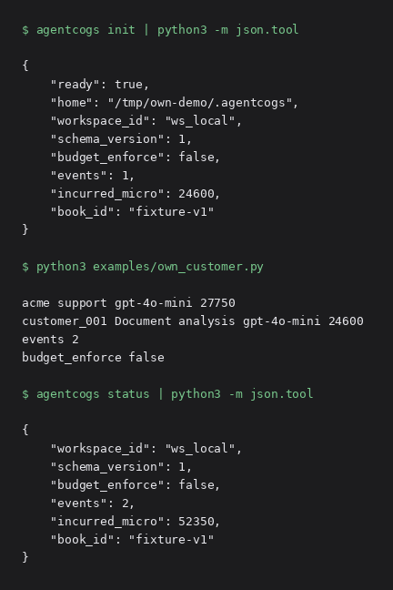

# Local mode

This is the install that does not need Docker, Postgres, or Redis. It is one workspace on the machine you already have. Production stays the deploy in [DEPLOY.md](DEPLOY.md).

```bash
pip install agentcogs
agentcogs init
agentcogs doctor
agentcogs start
```

`init` writes `.agentcogs/ledger.sqlite` in the current directory, or under `AGENTCOGS_HOME` if that is set. It loads the fixture price book and records one priced sample: customer `customer_001`, workflow Document analysis, model `gpt-4o-mini`, 8200 uncached input tokens, $0.0246. No OpenAI or Anthropic request is made. Budget enforcement is off.

That sample is not a live model call. When application code wraps an OpenAI or Anthropic client in `agentcogs.run()`, the posted cost is read from the usage on the response. `examples/priced_from_usage.py` runs that path against a local stand-in. No provider is contacted.

Running `init` again stops if that ledger file is already there. `agentcogs init --yes` keeps the file and does not wipe it.

`doctor` exits 0 when the ledger, the price book, and at least one event are present. It prints `ok`.

`status` prints the ledger counts: events, incurred micros, book id, and `budget_enforce`. After `init` that flag is false and the incurred total is 24600. `export` prints the same counts plus the events. Neither command turns enforcement on.

`start` listens on `127.0.0.1:3000` (`AGENTCOGS_PORT` overrides the port). `stop` ends that process. `demo` prints the same page. `backup` copies the database before a later schema change. `restore <file> --yes` replaces the current file. `update` reports whether the schema matches this package. It does not phone home.

`agentcogs ci` prints the cost comment for a controlled workload that moves from $0.031 to $0.048 an execution, which is 54.8%, and from $310 to $480 a month. Copy [examples/github-cost-check.yml](../examples/github-cost-check.yml) into a repository you pay the runners for. The comment does not fail the check.

`agentcogs budget` prints the Pro recommendation: a $49 price and a 70% target is a $14.70 budget and an $11.76 warning. The flag stays off.

A model name this package does not know is stored as a flag and is not saved as a $0 event.

A call in your own application is stored in this same file when no API key is set. `run()` reads the usage on the response, prices it with the book shipped in the package, and adds a row for that customer. The sample from `init` stays. No prompt or provider key is written. An unknown model is flagged and is not stored. `instrument()` only checks that a customer id was set. It does not write a row.

```python
import agentcogs
from openai import OpenAI

with agentcogs.run(customer_id="acme", workflow_id="support"):
    OpenAI().chat.completions.create(
        model="gpt-4o-mini",
        messages=[{"role": "user", "content": "ping"}],
    )
```

`agentcogs status` then includes `acme`. `examples/own_customer.py` runs that path against a stand-in in this repository, so no provider is contacted.



A Stripe customer with no fee stored leaves the margin blank. The product does not treat that as 0%.

The balance embed is `http://127.0.0.1:3000/embed/balance?customer=customer_001` after you store a credit allowance. The counts come from that ledger row.

Questions about a margin move are answered from months stored in the same file. The local assistant exposes a read tool only.
