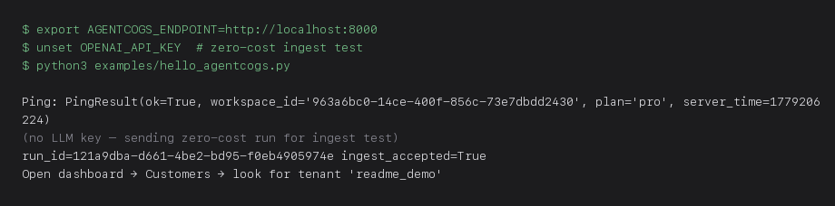
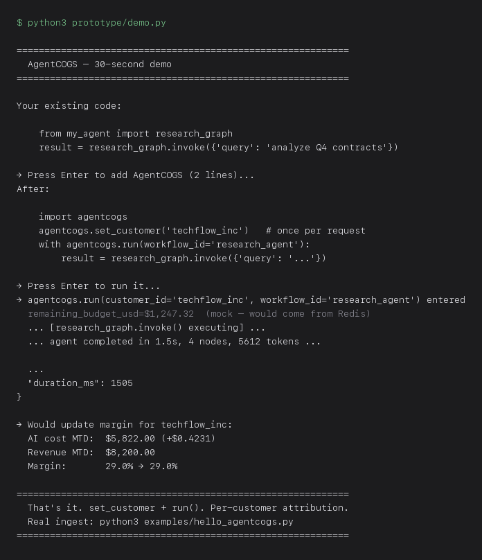
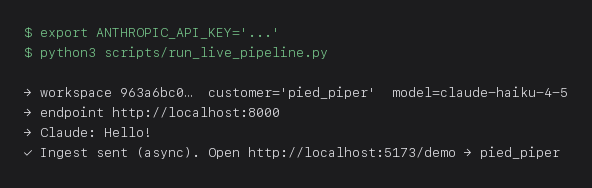
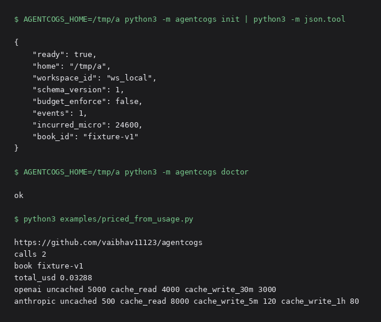
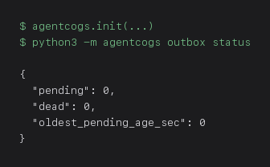
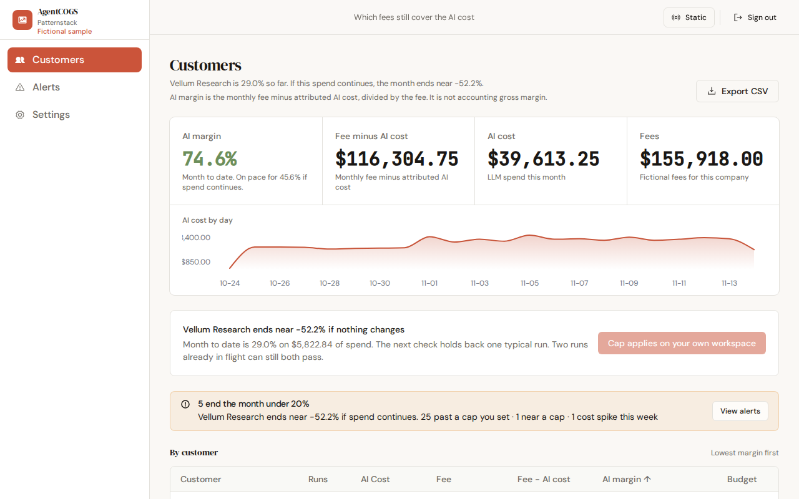
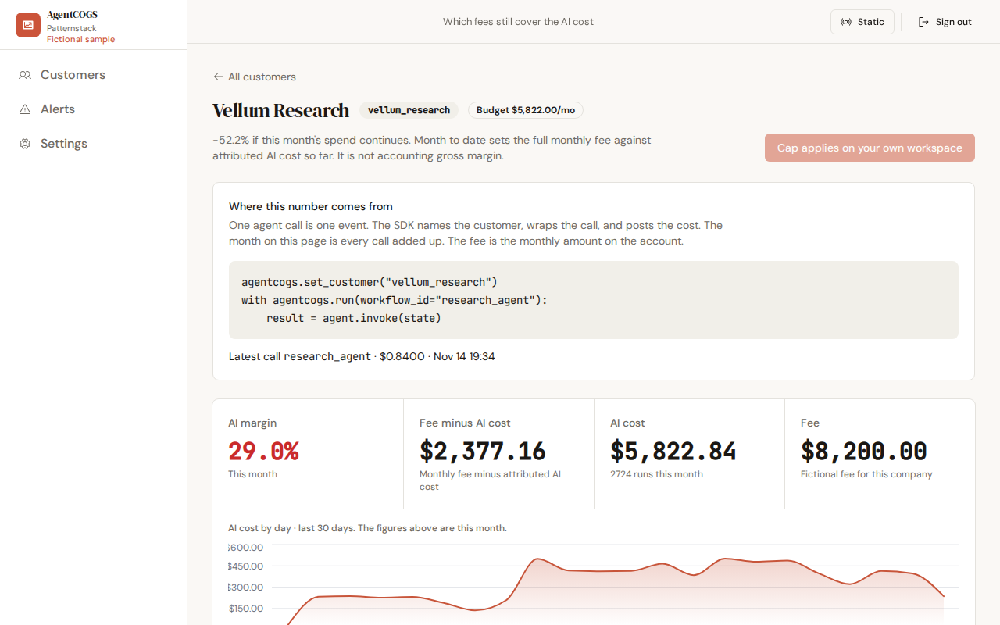

# Demo paths

Pick the script that matches your goal. The README shows the two most common paths; everything else is here.

| Goal | Command | What you get |
|------|---------|----------------|
| **One machine, no Docker** | `agentcogs init`, then `python3 examples/own_customer.py`, then `agentcogs status` | The sample plus your customer `acme` in the same ledger |
| **Price a call with no provider** | `python3 examples/priced_from_usage.py` | OpenAI and Anthropic usage priced on this machine |
| **Prove SDK → API** | `python3 examples/hello_agentcogs.py` | Real ingest; row in dashboard |
| **Sales call (no backend)** | `python3 prototype/demo.py` | Mock cost JSON; press Enter twice |
| **Check failed ingests** | `python3 -m agentcogs outbox status` | Local outbox queue |
| **Full local stack** | `./tools/seed_demo.sh && ./tools/start_demo.sh` | Docker + seeded UI at `/demo` |

`prototype/shekel_smoke.py` and `scripts/smoke/` are not in this tree. Do not follow an old capture that names them.

## Terminal — SDK proof (`hello_agentcogs.py`)

```bash
pip install agentcogs
set -a && source tools/.demo_env && set +a   # after seed_demo.sh
export AGENTCOGS_ENDPOINT=http://localhost:8000
python3 examples/hello_agentcogs.py
```



## Terminal — sales mock (`prototype/demo.py`)

No API keys. Interactive walkthrough; prints mock JSON (not real ingest).



## Terminal — live pipeline (`scripts/run_live_pipeline.py`)

```bash
export ANTHROPIC_API_KEY='...'
python3 scripts/run_live_pipeline.py --customer kindred_notes
```



## Terminal — priced usage, no provider (`examples/priced_from_usage.py`)

```bash
python3 examples/priced_from_usage.py
```

The clients talk to a stand-in in this repository. The printed total is the fixture book.



## Terminal — outbox



## Dashboard UI

After `./tools/seed_demo.sh && ./tools/start_demo.sh` → http://localhost:5173/demo

| View | Screenshot |
|------|------------|
| **Customers** |  |
| **Vellum Research** |  |

Regenerate assets: [assets/terminal/README.md](assets/terminal/README.md).
